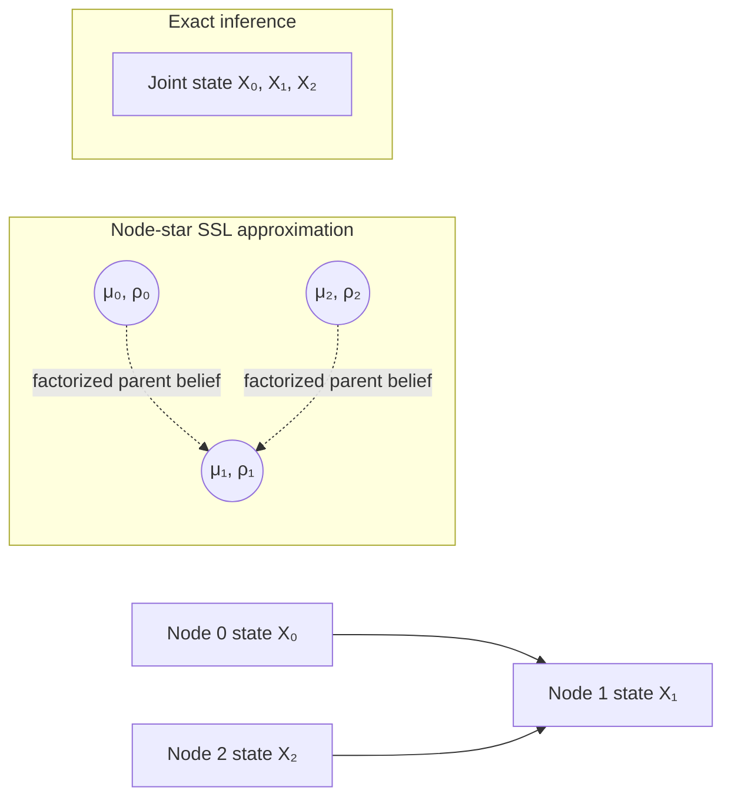
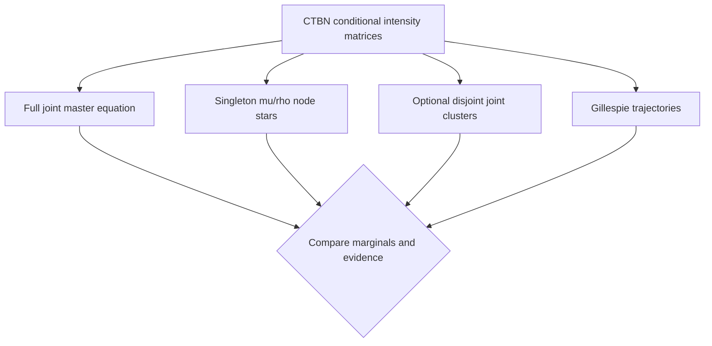
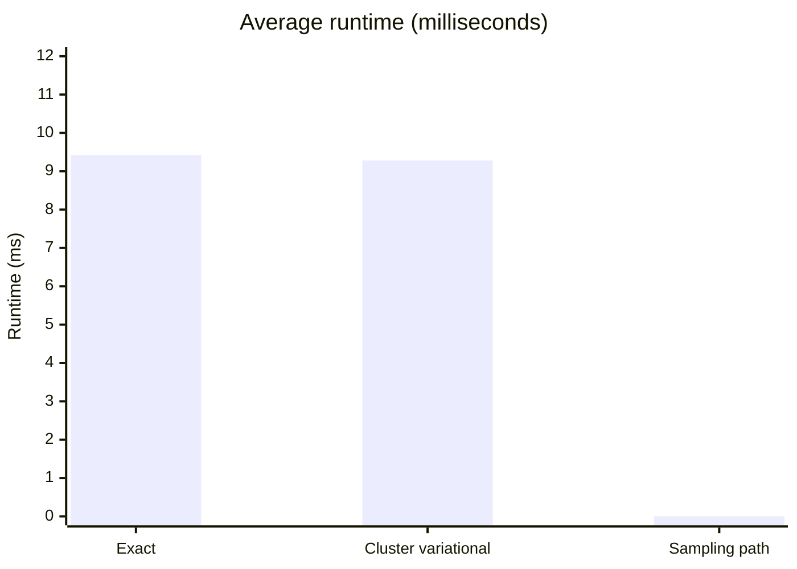
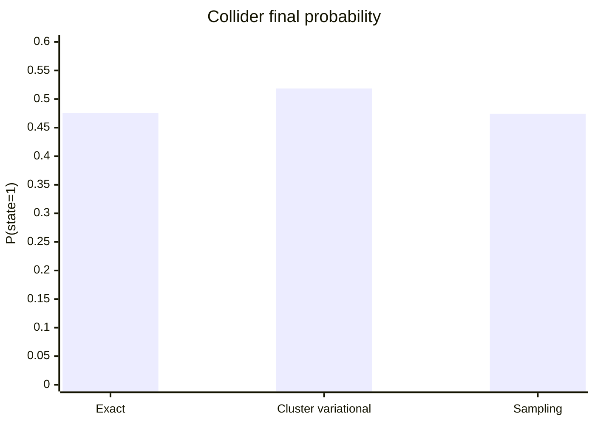
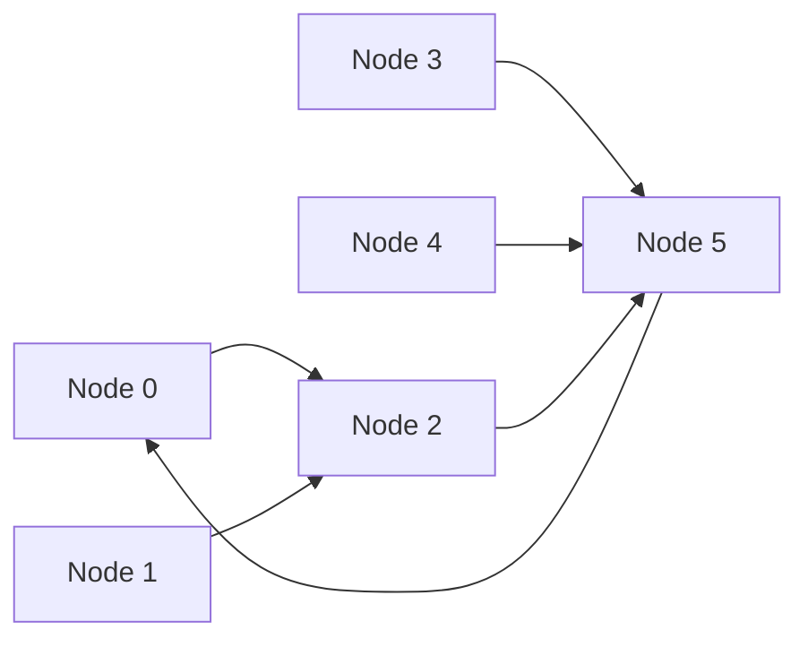
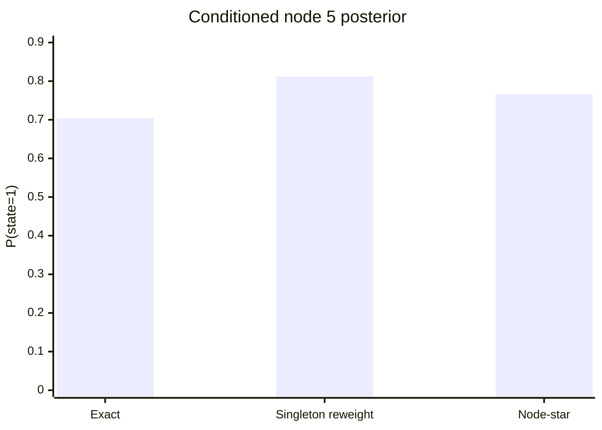
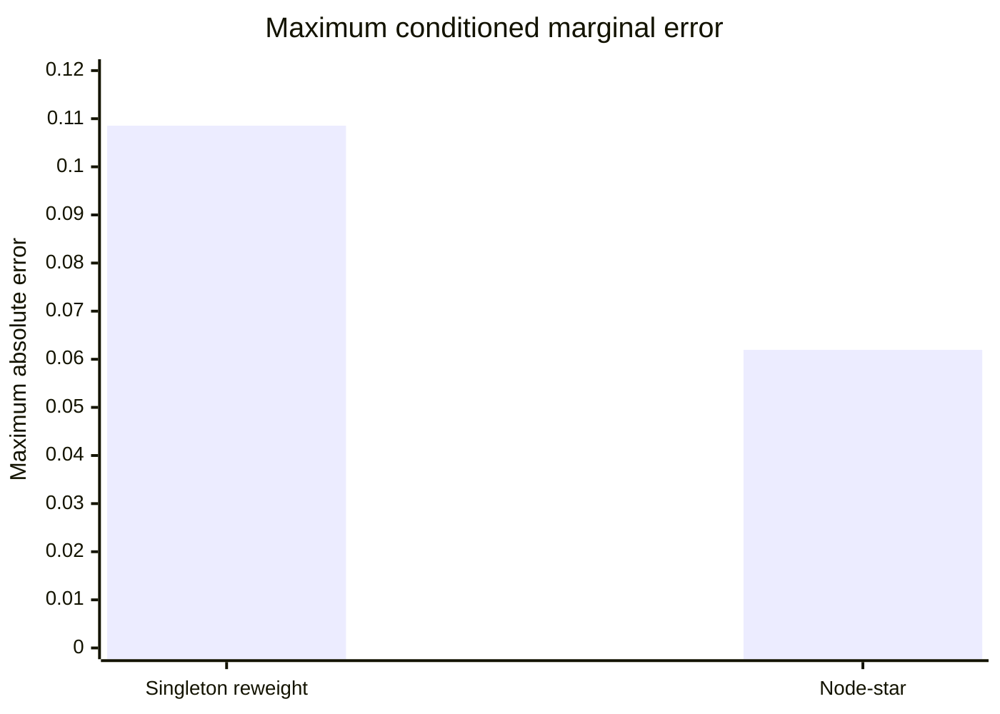

# ruCTBN

Rust implementation of continuous-time Bayesian networks (CTBNs), with structure learning, trajectory sampling, exact state-space dynamics, the SSL-CTBN node-star forward/backward approximation, and an optional disjoint-cluster mean-field extension.

## Build and test

```bash
cargo build
cargo test
cargo run
```

The package uses the stable Rust toolchain declared in `rust-toolchain`.

## Dynamics inference

The library exposes three numerical propagation methods:

- `exact_dynamics`: propagates the full joint CTBN master equation.
- `star_variational_dynamics`: convenience entry point for a fixed CIM. It runs the SSL-CTBN node-star fixed point with a degenerate rate model, where the arithmetic and geometric posterior expected rates coincide.
- `star_variational_dynamics_with_rates`: the paper-faithful entry point for uncertain or mixture posterior CIMs. It accepts separate arithmetic and geometric expected rate matrices and maintains one singleton forward marginal `mu_i`, one backward response `rho_i`, child-response coupling, and expected dwell/transition statistics per node. Parent configurations are averaged from products of singleton parent marginals; no disjoint cluster partition is supplied.
- `cluster_mean_field_dynamics`: an optional disjoint-cluster forward extension. It retains joint correlations inside user-selected clusters and factorizes between clusters. Its old name, `cluster_variational_dynamics`, remains as a compatibility alias, but manually defined disjoint clusters are not the clustering used by the MATLAB/Python SSL-CTBN node-star method.

All propagators use fourth-order Runge-Kutta integration. The star implementation follows Equations 10–12 and Algorithm 1 of the SSL-CTBN paper, including noisy-observation jump conditions.

```rust
use ctbn::dynamics::{cluster_mean_field_dynamics, exact_dynamics};
use ctbn::star::{
    star_variational_dynamics_with_rates, StarConfig, StarRateModel,
};

// Three-node coupled v-structure: X0 -> X1 <- X2.
let exact = exact_dynamics(&ctbn, &[0, 0, 0], 1.0, 0.002)?;
let rate_model = StarRateModel::degenerate(&ctbn);
let star = star_variational_dynamics_with_rates(
    &ctbn,
    &rate_model, // In learning, supply distinct R and tilde-R matrices here.
    &[0, 0, 0],
    &[],
    1.0,
    0.002,
    &StarConfig::default(),
)?;
let cluster_extension = cluster_mean_field_dynamics(
    &ctbn,
    &[0, 0, 0],
    &[vec![0], vec![1], vec![2]],
    1.0,
    0.002,
)?;
```



### Node-star equations

For node `i`, the star solver alternates the equations corresponding to the historical MATLAB implementation and StarCTBN reference:

1. Compute the parent-configuration distribution as a product of singleton parent beliefs:

   \[
   q_i^u(t) \approx \prod_{j\in\operatorname{pa}(i)} q_j(t,u_j).
   \]

2. Compute two parent-averaged matrices. The arithmetic posterior expectation `R_i` is used in diagonal backward dynamics and in the subtraction term of the child response. The geometric posterior mean `tilde R_i` is used for off-diagonal backward/forward flow and expected transition counts. The distinction is essential: for mixture/posterior CIMs, generally `R_i != tilde R_i`. Only the degenerate fixed-CIM case satisfies equality, explaining why that special no-evidence fixed point reduces to singleton mean field.

   \[
   \Psi_i(x,t)=\sum_c\sum_{z\neq z'} q_c(z,t)q_c^{u\setminus i}(t)
   \left(\tilde R_c(z,z'\mid x,u\setminus i)
   \frac{\rho_c(z',t)}{\rho_c(z,t)}-R_c(z,z'\mid x,u\setminus i)\right).
   \]

3. Integrate `rho_i` backward between observations using geometric off-diagonal rates and the arithmetic diagonal exit rate, applying each observation likelihood as a jump.
4. Integrate `mu_i` forward with tilted geometric rates `tilde R_i(x,x') rho_i(x') / rho_i(x)`.
5. Integrate dwell statistics from `mu_i` and parent marginals, and transition statistics with the geometric rate and `rho_i(x') / rho_i(x)` ratio.

The implementation exposes the resulting `dwell_times` and `transitions` in `StarResult` for the EM maximization step.

This is why the method uses overlapping **node-parent/child stars**, not a manual disjoint partition. The compatibility cluster API is a separate approximation and should not be confused with it.

Exact inference stores every global state, so its state space grows as the product of local dimensions. The optional disjoint-cluster extension stores only the state product for each configured cluster.



## Validation

The dynamics tests validate:

1. Exact propagation against the analytic two-state solution.
2. Exact marginals against 20,000 seeded Gillespie paths.
3. Node-star marginals and expected statistics against exact single-node dynamics.
4. Noisy terminal observations against the reweighted posterior probability.
5. Distinct arithmetic/geometric rate matrices to ensure node-star uses geometric expected rates for forward flow rather than silently collapsing to plain mean field.
6. Optional disjoint-cluster mean-field marginals against exact inference.
7. Probability normalization and non-negativity throughout propagation.

Run only the dynamics checks with:

```bash
cargo test dynamics::tests
```

The faithful star solver follows the parent-neighborhood equations in the historical `ssl-ctbn` MATLAB code and the cleaner [StarCTBN Python reference](https://github.com/AdrianSosic/StarCTBN). Parent neighborhoods define the conditional rates, but are not stored as joint clusters: their configurations are averaged using products of singleton marginals. “Subsets” in the MATLAB learning code are sparse-regression rate components, not variational clusters. The Rust package does not depend on either historical implementation at runtime.

## Benchmarks

Run the reproducible release benchmark with:

```bash
cargo run --release --example dynamics_benchmark
```

Workload: three binary nodes in the coupled v-structure `X0 -> X1 <- X2`, duration `0.7`, integration step `0.002`, 100 inference repetitions, and 20,000 seeded sampled paths. The collider `X1` has rates conditional on both parents. Measurements are machine-dependent and exclude Cargo compilation time.

### Reference results

Measured on macOS 13.6, Intel Core i7-7820HQ at 2.90 GHz, Rust stable:

| Method | Average time | Collider `P(state=1)` |
|---|---:|---:|
| Exact master equation | 9.427 ms/run | 0.475448 |
| Singleton disjoint mean-field extension | 9.280 ms/run | 0.518534 |
| Gillespie sampling | 4.176 µs/path | 0.474150 |

The singleton disjoint-mean-field maximum absolute marginal error in this workload is `0.043086`. The six-node comparison below exercises a non-degenerate node-star model with separate `R` and `tilde R`, demonstrating that the paper-specific rate handling is active rather than silently collapsing to singleton mean field.





In this three-node v-structure, exact inference tracks eight joint states while the singleton-cluster solver tracks six one-node states. The collider's conditional rates depend on both parents, illustrating the interaction between coupled parents. Larger networks increase the full joint state space exponentially; increasing cluster size trades additional runtime and memory for retained correlations and exactness.

### Six-node conditioned benchmark

The conditioned benchmark uses two coupled v-structures and a directed cycle:



This is the relevant comparison for node-star inference: all solvers use the same fixed CIM, the same fixed initial state, and the same terminal noisy observation. Comparing node-star with a separate arithmetic/geometric posterior model to a fixed-CIM exact solver was invalid and has been removed.

At `T=0.7`, the observation likelihoods are `[0.95,0.05]`, `[0.05,0.95]`, `[0.90,0.10]`, `[0.10,0.90]`, `[0.85,0.15]`, and `[0.15,0.85]` for nodes 0–5. The exact posterior is obtained by weighting the 64-state joint terminal distribution. The independent baseline weights each node’s exact terminal prior marginal by its own observation, discarding joint dependence.

| Posterior solver | Node 5 `P(state=1)` | Maximum marginal error |
|---|---:|---:|
| Exact joint posterior | 0.703624 | 0 |
| Independent singleton reweighting | 0.812171 | 0.108546 |
| SSL node-star | 0.765575 | 0.061950 |

On this same-model posterior task, node-star reduces the maximum marginal error by about 43% relative to independent singleton reweighting. It does not reproduce the exact joint posterior—star is still an approximation—but it performs better by propagating observation information through overlapping child-parent stars.





The node-star solve is approximately 160 ms for this workload. Runtime is secondary to posterior accuracy here: the method’s forward/backward iteration exists specifically for conditioning on observations. Without evidence and with a degenerate fixed CIM, `rho` remains constant and node-star appropriately reduces to mean field.

To add a benchmark to the tables, update `examples/dynamics_benchmark.rs`, run it in release mode, and report the machine, model, evidence, and full result.
